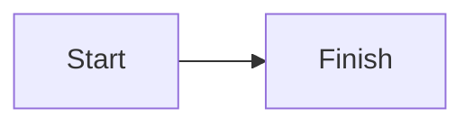
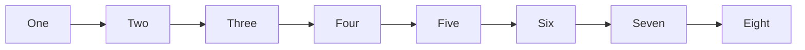
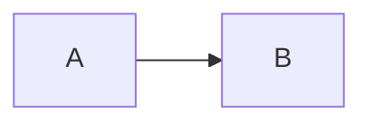
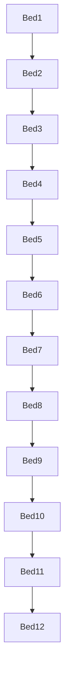

# Mermaid diagrams

Standard fenced diagram; click the diagram to edit its source with a preview below:



Wide diagram scrolls sideways at its drawn size:



Tilde fence, mixed-case language, and preserved extra info:

~~~Mermaid title="workflow"
sequenceDiagram
  Alice->>Bob: Hello
~~~

Configuration directive stays editable as source:



Malformed diagram stays editable as source:

```mermaid
flowchart LR
  A[unterminated
```

Unknown language remains an ordinary code block:

```mermaidish
flowchart LR
  A --> B
```

## A rendered diagram stays fully visible

This 12-line Mermaid source renders as one complete diagram. Click it to edit the source and leave it to restore the full diagram; the rendered image has no collapse controls.


