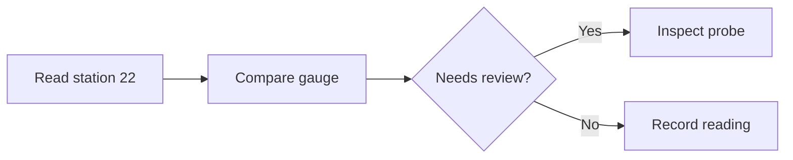

# Large Mixed Document

This bounded manual workload contains 24 highlighted code blocks of 25 lines each and 12 Mermaid diagrams, spread across 24 sections. It exercises reading and scrolling while highlighting and diagram rendering catch up; it is not a timing benchmark or a claim about maximum document size.

Open it afresh, scroll quickly to the middle and end, then return to the start. Text and code should remain editable while work finishes. Expand all code blocks to compare the larger layout. Switch appearances and inspect diagrams both before and after scrolling them into view.

Use a short window to make the outline overflow. Hover the dots and move toward either end: the list scrolls and fades where more headings lie beyond it. Move over the titles to hold the list still, then choose Station 24. Navigation must reach that station even while earlier code is collapsed. Tab into the outline and repeat with Home, End, and Enter; Escape returns focus.

In a scratch copy, edit a code block immediately after opening, before all highlighting has settled, and Undo. Save and reopen to verify its source. Use Find for `LAST-STATION-TARGET` to reach the final section, and confirm that navigation remains responsive. Rendering and folding alone should never dirty the file.

## Station 01
Station 01 records the same small analysis program against a separate sample. Its heading and paragraph identify the destination when navigating from the outline. The examples are intentionally repeated to create a predictable amount of rendering work.
```typescript
interface Reading {
  bed: string;
  moisture: number;
  inspected: boolean;
}

const readings: Reading[] = [
  { bed: "north-01", moisture: 31, inspected: true },
  { bed: "south-01", moisture: 42, inspected: false },
  { bed: "herbs", moisture: 38, inspected: true },
];

const summarize = (items: Reading[]) => {
  const inspected = items.filter((item) => item.inspected);
  const dry = inspected.filter((item) => item.moisture < 35);

  return {
    inspected: inspected.length,
    followUp: dry.map((item) => item.bed),
  };
};

const report = summarize(readings);
console.log("Inspected beds:", report.inspected);
console.log("Follow-up beds:", report.followUp.join(", "));
```

The next station repeats the workload with a different identifier. Scrolling past this paragraph should not change its text or the code it follows.

## Station 02
Station 02 records the same small analysis program against a separate sample. Its heading and paragraph identify the destination when navigating from the outline. The examples are intentionally repeated to create a predictable amount of rendering work.
```typescript
interface Reading {
  bed: string;
  moisture: number;
  inspected: boolean;
}

const readings: Reading[] = [
  { bed: "north-02", moisture: 31, inspected: true },
  { bed: "south-02", moisture: 42, inspected: false },
  { bed: "herbs", moisture: 38, inspected: true },
];

const summarize = (items: Reading[]) => {
  const inspected = items.filter((item) => item.inspected);
  const dry = inspected.filter((item) => item.moisture < 35);

  return {
    inspected: inspected.length,
    followUp: dry.map((item) => item.bed),
  };
};

const report = summarize(readings);
console.log("Inspected beds:", report.inspected);
console.log("Follow-up beds:", report.followUp.join(", "));
```


The next station repeats the workload with a different identifier. Scrolling past this paragraph should not change its text or the code it follows.

## Station 03
Station 03 records the same small analysis program against a separate sample. Its heading and paragraph identify the destination when navigating from the outline. The examples are intentionally repeated to create a predictable amount of rendering work.
```typescript
interface Reading {
  bed: string;
  moisture: number;
  inspected: boolean;
}

const readings: Reading[] = [
  { bed: "north-03", moisture: 31, inspected: true },
  { bed: "south-03", moisture: 42, inspected: false },
  { bed: "herbs", moisture: 38, inspected: true },
];

const summarize = (items: Reading[]) => {
  const inspected = items.filter((item) => item.inspected);
  const dry = inspected.filter((item) => item.moisture < 35);

  return {
    inspected: inspected.length,
    followUp: dry.map((item) => item.bed),
  };
};

const report = summarize(readings);
console.log("Inspected beds:", report.inspected);
console.log("Follow-up beds:", report.followUp.join(", "));
```

The next station repeats the workload with a different identifier. Scrolling past this paragraph should not change its text or the code it follows.

## Station 04
Station 04 records the same small analysis program against a separate sample. Its heading and paragraph identify the destination when navigating from the outline. The examples are intentionally repeated to create a predictable amount of rendering work.
```typescript
interface Reading {
  bed: string;
  moisture: number;
  inspected: boolean;
}

const readings: Reading[] = [
  { bed: "north-04", moisture: 31, inspected: true },
  { bed: "south-04", moisture: 42, inspected: false },
  { bed: "herbs", moisture: 38, inspected: true },
];

const summarize = (items: Reading[]) => {
  const inspected = items.filter((item) => item.inspected);
  const dry = inspected.filter((item) => item.moisture < 35);

  return {
    inspected: inspected.length,
    followUp: dry.map((item) => item.bed),
  };
};

const report = summarize(readings);
console.log("Inspected beds:", report.inspected);
console.log("Follow-up beds:", report.followUp.join(", "));
```


The next station repeats the workload with a different identifier. Scrolling past this paragraph should not change its text or the code it follows.

## Station 05
Station 05 records the same small analysis program against a separate sample. Its heading and paragraph identify the destination when navigating from the outline. The examples are intentionally repeated to create a predictable amount of rendering work.
```typescript
interface Reading {
  bed: string;
  moisture: number;
  inspected: boolean;
}

const readings: Reading[] = [
  { bed: "north-05", moisture: 31, inspected: true },
  { bed: "south-05", moisture: 42, inspected: false },
  { bed: "herbs", moisture: 38, inspected: true },
];

const summarize = (items: Reading[]) => {
  const inspected = items.filter((item) => item.inspected);
  const dry = inspected.filter((item) => item.moisture < 35);

  return {
    inspected: inspected.length,
    followUp: dry.map((item) => item.bed),
  };
};

const report = summarize(readings);
console.log("Inspected beds:", report.inspected);
console.log("Follow-up beds:", report.followUp.join(", "));
```

The next station repeats the workload with a different identifier. Scrolling past this paragraph should not change its text or the code it follows.

## Station 06
Station 06 records the same small analysis program against a separate sample. Its heading and paragraph identify the destination when navigating from the outline. The examples are intentionally repeated to create a predictable amount of rendering work.
```typescript
interface Reading {
  bed: string;
  moisture: number;
  inspected: boolean;
}

const readings: Reading[] = [
  { bed: "north-06", moisture: 31, inspected: true },
  { bed: "south-06", moisture: 42, inspected: false },
  { bed: "herbs", moisture: 38, inspected: true },
];

const summarize = (items: Reading[]) => {
  const inspected = items.filter((item) => item.inspected);
  const dry = inspected.filter((item) => item.moisture < 35);

  return {
    inspected: inspected.length,
    followUp: dry.map((item) => item.bed),
  };
};

const report = summarize(readings);
console.log("Inspected beds:", report.inspected);
console.log("Follow-up beds:", report.followUp.join(", "));
```


The next station repeats the workload with a different identifier. Scrolling past this paragraph should not change its text or the code it follows.

## Station 07
Station 07 records the same small analysis program against a separate sample. Its heading and paragraph identify the destination when navigating from the outline. The examples are intentionally repeated to create a predictable amount of rendering work.
```typescript
interface Reading {
  bed: string;
  moisture: number;
  inspected: boolean;
}

const readings: Reading[] = [
  { bed: "north-07", moisture: 31, inspected: true },
  { bed: "south-07", moisture: 42, inspected: false },
  { bed: "herbs", moisture: 38, inspected: true },
];

const summarize = (items: Reading[]) => {
  const inspected = items.filter((item) => item.inspected);
  const dry = inspected.filter((item) => item.moisture < 35);

  return {
    inspected: inspected.length,
    followUp: dry.map((item) => item.bed),
  };
};

const report = summarize(readings);
console.log("Inspected beds:", report.inspected);
console.log("Follow-up beds:", report.followUp.join(", "));
```

The next station repeats the workload with a different identifier. Scrolling past this paragraph should not change its text or the code it follows.

## Station 08
Station 08 records the same small analysis program against a separate sample. Its heading and paragraph identify the destination when navigating from the outline. The examples are intentionally repeated to create a predictable amount of rendering work.
```typescript
interface Reading {
  bed: string;
  moisture: number;
  inspected: boolean;
}

const readings: Reading[] = [
  { bed: "north-08", moisture: 31, inspected: true },
  { bed: "south-08", moisture: 42, inspected: false },
  { bed: "herbs", moisture: 38, inspected: true },
];

const summarize = (items: Reading[]) => {
  const inspected = items.filter((item) => item.inspected);
  const dry = inspected.filter((item) => item.moisture < 35);

  return {
    inspected: inspected.length,
    followUp: dry.map((item) => item.bed),
  };
};

const report = summarize(readings);
console.log("Inspected beds:", report.inspected);
console.log("Follow-up beds:", report.followUp.join(", "));
```


The next station repeats the workload with a different identifier. Scrolling past this paragraph should not change its text or the code it follows.

## Station 09
Station 09 records the same small analysis program against a separate sample. Its heading and paragraph identify the destination when navigating from the outline. The examples are intentionally repeated to create a predictable amount of rendering work.
```typescript
interface Reading {
  bed: string;
  moisture: number;
  inspected: boolean;
}

const readings: Reading[] = [
  { bed: "north-09", moisture: 31, inspected: true },
  { bed: "south-09", moisture: 42, inspected: false },
  { bed: "herbs", moisture: 38, inspected: true },
];

const summarize = (items: Reading[]) => {
  const inspected = items.filter((item) => item.inspected);
  const dry = inspected.filter((item) => item.moisture < 35);

  return {
    inspected: inspected.length,
    followUp: dry.map((item) => item.bed),
  };
};

const report = summarize(readings);
console.log("Inspected beds:", report.inspected);
console.log("Follow-up beds:", report.followUp.join(", "));
```

The next station repeats the workload with a different identifier. Scrolling past this paragraph should not change its text or the code it follows.

## Station 10
Station 10 records the same small analysis program against a separate sample. Its heading and paragraph identify the destination when navigating from the outline. The examples are intentionally repeated to create a predictable amount of rendering work.
```typescript
interface Reading {
  bed: string;
  moisture: number;
  inspected: boolean;
}

const readings: Reading[] = [
  { bed: "north-10", moisture: 31, inspected: true },
  { bed: "south-10", moisture: 42, inspected: false },
  { bed: "herbs", moisture: 38, inspected: true },
];

const summarize = (items: Reading[]) => {
  const inspected = items.filter((item) => item.inspected);
  const dry = inspected.filter((item) => item.moisture < 35);

  return {
    inspected: inspected.length,
    followUp: dry.map((item) => item.bed),
  };
};

const report = summarize(readings);
console.log("Inspected beds:", report.inspected);
console.log("Follow-up beds:", report.followUp.join(", "));
```


The next station repeats the workload with a different identifier. Scrolling past this paragraph should not change its text or the code it follows.

## Station 11
Station 11 records the same small analysis program against a separate sample. Its heading and paragraph identify the destination when navigating from the outline. The examples are intentionally repeated to create a predictable amount of rendering work.
```typescript
interface Reading {
  bed: string;
  moisture: number;
  inspected: boolean;
}

const readings: Reading[] = [
  { bed: "north-11", moisture: 31, inspected: true },
  { bed: "south-11", moisture: 42, inspected: false },
  { bed: "herbs", moisture: 38, inspected: true },
];

const summarize = (items: Reading[]) => {
  const inspected = items.filter((item) => item.inspected);
  const dry = inspected.filter((item) => item.moisture < 35);

  return {
    inspected: inspected.length,
    followUp: dry.map((item) => item.bed),
  };
};

const report = summarize(readings);
console.log("Inspected beds:", report.inspected);
console.log("Follow-up beds:", report.followUp.join(", "));
```

The next station repeats the workload with a different identifier. Scrolling past this paragraph should not change its text or the code it follows.

## Station 12
Station 12 records the same small analysis program against a separate sample. Its heading and paragraph identify the destination when navigating from the outline. The examples are intentionally repeated to create a predictable amount of rendering work.
```typescript
interface Reading {
  bed: string;
  moisture: number;
  inspected: boolean;
}

const readings: Reading[] = [
  { bed: "north-12", moisture: 31, inspected: true },
  { bed: "south-12", moisture: 42, inspected: false },
  { bed: "herbs", moisture: 38, inspected: true },
];

const summarize = (items: Reading[]) => {
  const inspected = items.filter((item) => item.inspected);
  const dry = inspected.filter((item) => item.moisture < 35);

  return {
    inspected: inspected.length,
    followUp: dry.map((item) => item.bed),
  };
};

const report = summarize(readings);
console.log("Inspected beds:", report.inspected);
console.log("Follow-up beds:", report.followUp.join(", "));
```


The next station repeats the workload with a different identifier. Scrolling past this paragraph should not change its text or the code it follows.

## Station 13
Station 13 records the same small analysis program against a separate sample. Its heading and paragraph identify the destination when navigating from the outline. The examples are intentionally repeated to create a predictable amount of rendering work.
```typescript
interface Reading {
  bed: string;
  moisture: number;
  inspected: boolean;
}

const readings: Reading[] = [
  { bed: "north-13", moisture: 31, inspected: true },
  { bed: "south-13", moisture: 42, inspected: false },
  { bed: "herbs", moisture: 38, inspected: true },
];

const summarize = (items: Reading[]) => {
  const inspected = items.filter((item) => item.inspected);
  const dry = inspected.filter((item) => item.moisture < 35);

  return {
    inspected: inspected.length,
    followUp: dry.map((item) => item.bed),
  };
};

const report = summarize(readings);
console.log("Inspected beds:", report.inspected);
console.log("Follow-up beds:", report.followUp.join(", "));
```

The next station repeats the workload with a different identifier. Scrolling past this paragraph should not change its text or the code it follows.

## Station 14
Station 14 records the same small analysis program against a separate sample. Its heading and paragraph identify the destination when navigating from the outline. The examples are intentionally repeated to create a predictable amount of rendering work.
```typescript
interface Reading {
  bed: string;
  moisture: number;
  inspected: boolean;
}

const readings: Reading[] = [
  { bed: "north-14", moisture: 31, inspected: true },
  { bed: "south-14", moisture: 42, inspected: false },
  { bed: "herbs", moisture: 38, inspected: true },
];

const summarize = (items: Reading[]) => {
  const inspected = items.filter((item) => item.inspected);
  const dry = inspected.filter((item) => item.moisture < 35);

  return {
    inspected: inspected.length,
    followUp: dry.map((item) => item.bed),
  };
};

const report = summarize(readings);
console.log("Inspected beds:", report.inspected);
console.log("Follow-up beds:", report.followUp.join(", "));
```


The next station repeats the workload with a different identifier. Scrolling past this paragraph should not change its text or the code it follows.

## Station 15
Station 15 records the same small analysis program against a separate sample. Its heading and paragraph identify the destination when navigating from the outline. The examples are intentionally repeated to create a predictable amount of rendering work.
```typescript
interface Reading {
  bed: string;
  moisture: number;
  inspected: boolean;
}

const readings: Reading[] = [
  { bed: "north-15", moisture: 31, inspected: true },
  { bed: "south-15", moisture: 42, inspected: false },
  { bed: "herbs", moisture: 38, inspected: true },
];

const summarize = (items: Reading[]) => {
  const inspected = items.filter((item) => item.inspected);
  const dry = inspected.filter((item) => item.moisture < 35);

  return {
    inspected: inspected.length,
    followUp: dry.map((item) => item.bed),
  };
};

const report = summarize(readings);
console.log("Inspected beds:", report.inspected);
console.log("Follow-up beds:", report.followUp.join(", "));
```

The next station repeats the workload with a different identifier. Scrolling past this paragraph should not change its text or the code it follows.

## Station 16
Station 16 records the same small analysis program against a separate sample. Its heading and paragraph identify the destination when navigating from the outline. The examples are intentionally repeated to create a predictable amount of rendering work.
```typescript
interface Reading {
  bed: string;
  moisture: number;
  inspected: boolean;
}

const readings: Reading[] = [
  { bed: "north-16", moisture: 31, inspected: true },
  { bed: "south-16", moisture: 42, inspected: false },
  { bed: "herbs", moisture: 38, inspected: true },
];

const summarize = (items: Reading[]) => {
  const inspected = items.filter((item) => item.inspected);
  const dry = inspected.filter((item) => item.moisture < 35);

  return {
    inspected: inspected.length,
    followUp: dry.map((item) => item.bed),
  };
};

const report = summarize(readings);
console.log("Inspected beds:", report.inspected);
console.log("Follow-up beds:", report.followUp.join(", "));
```


The next station repeats the workload with a different identifier. Scrolling past this paragraph should not change its text or the code it follows.

## Station 17
Station 17 records the same small analysis program against a separate sample. Its heading and paragraph identify the destination when navigating from the outline. The examples are intentionally repeated to create a predictable amount of rendering work.
```typescript
interface Reading {
  bed: string;
  moisture: number;
  inspected: boolean;
}

const readings: Reading[] = [
  { bed: "north-17", moisture: 31, inspected: true },
  { bed: "south-17", moisture: 42, inspected: false },
  { bed: "herbs", moisture: 38, inspected: true },
];

const summarize = (items: Reading[]) => {
  const inspected = items.filter((item) => item.inspected);
  const dry = inspected.filter((item) => item.moisture < 35);

  return {
    inspected: inspected.length,
    followUp: dry.map((item) => item.bed),
  };
};

const report = summarize(readings);
console.log("Inspected beds:", report.inspected);
console.log("Follow-up beds:", report.followUp.join(", "));
```

The next station repeats the workload with a different identifier. Scrolling past this paragraph should not change its text or the code it follows.

## Station 18
Station 18 records the same small analysis program against a separate sample. Its heading and paragraph identify the destination when navigating from the outline. The examples are intentionally repeated to create a predictable amount of rendering work.
```typescript
interface Reading {
  bed: string;
  moisture: number;
  inspected: boolean;
}

const readings: Reading[] = [
  { bed: "north-18", moisture: 31, inspected: true },
  { bed: "south-18", moisture: 42, inspected: false },
  { bed: "herbs", moisture: 38, inspected: true },
];

const summarize = (items: Reading[]) => {
  const inspected = items.filter((item) => item.inspected);
  const dry = inspected.filter((item) => item.moisture < 35);

  return {
    inspected: inspected.length,
    followUp: dry.map((item) => item.bed),
  };
};

const report = summarize(readings);
console.log("Inspected beds:", report.inspected);
console.log("Follow-up beds:", report.followUp.join(", "));
```


The next station repeats the workload with a different identifier. Scrolling past this paragraph should not change its text or the code it follows.

## Station 19
Station 19 records the same small analysis program against a separate sample. Its heading and paragraph identify the destination when navigating from the outline. The examples are intentionally repeated to create a predictable amount of rendering work.
```typescript
interface Reading {
  bed: string;
  moisture: number;
  inspected: boolean;
}

const readings: Reading[] = [
  { bed: "north-19", moisture: 31, inspected: true },
  { bed: "south-19", moisture: 42, inspected: false },
  { bed: "herbs", moisture: 38, inspected: true },
];

const summarize = (items: Reading[]) => {
  const inspected = items.filter((item) => item.inspected);
  const dry = inspected.filter((item) => item.moisture < 35);

  return {
    inspected: inspected.length,
    followUp: dry.map((item) => item.bed),
  };
};

const report = summarize(readings);
console.log("Inspected beds:", report.inspected);
console.log("Follow-up beds:", report.followUp.join(", "));
```

The next station repeats the workload with a different identifier. Scrolling past this paragraph should not change its text or the code it follows.

## Station 20
Station 20 records the same small analysis program against a separate sample. Its heading and paragraph identify the destination when navigating from the outline. The examples are intentionally repeated to create a predictable amount of rendering work.
```typescript
interface Reading {
  bed: string;
  moisture: number;
  inspected: boolean;
}

const readings: Reading[] = [
  { bed: "north-20", moisture: 31, inspected: true },
  { bed: "south-20", moisture: 42, inspected: false },
  { bed: "herbs", moisture: 38, inspected: true },
];

const summarize = (items: Reading[]) => {
  const inspected = items.filter((item) => item.inspected);
  const dry = inspected.filter((item) => item.moisture < 35);

  return {
    inspected: inspected.length,
    followUp: dry.map((item) => item.bed),
  };
};

const report = summarize(readings);
console.log("Inspected beds:", report.inspected);
console.log("Follow-up beds:", report.followUp.join(", "));
```


The next station repeats the workload with a different identifier. Scrolling past this paragraph should not change its text or the code it follows.

## Station 21
Station 21 records the same small analysis program against a separate sample. Its heading and paragraph identify the destination when navigating from the outline. The examples are intentionally repeated to create a predictable amount of rendering work.
```typescript
interface Reading {
  bed: string;
  moisture: number;
  inspected: boolean;
}

const readings: Reading[] = [
  { bed: "north-21", moisture: 31, inspected: true },
  { bed: "south-21", moisture: 42, inspected: false },
  { bed: "herbs", moisture: 38, inspected: true },
];

const summarize = (items: Reading[]) => {
  const inspected = items.filter((item) => item.inspected);
  const dry = inspected.filter((item) => item.moisture < 35);

  return {
    inspected: inspected.length,
    followUp: dry.map((item) => item.bed),
  };
};

const report = summarize(readings);
console.log("Inspected beds:", report.inspected);
console.log("Follow-up beds:", report.followUp.join(", "));
```

The next station repeats the workload with a different identifier. Scrolling past this paragraph should not change its text or the code it follows.

## Station 22
Station 22 records the same small analysis program against a separate sample. Its heading and paragraph identify the destination when navigating from the outline. The examples are intentionally repeated to create a predictable amount of rendering work.
```typescript
interface Reading {
  bed: string;
  moisture: number;
  inspected: boolean;
}

const readings: Reading[] = [
  { bed: "north-22", moisture: 31, inspected: true },
  { bed: "south-22", moisture: 42, inspected: false },
  { bed: "herbs", moisture: 38, inspected: true },
];

const summarize = (items: Reading[]) => {
  const inspected = items.filter((item) => item.inspected);
  const dry = inspected.filter((item) => item.moisture < 35);

  return {
    inspected: inspected.length,
    followUp: dry.map((item) => item.bed),
  };
};

const report = summarize(readings);
console.log("Inspected beds:", report.inspected);
console.log("Follow-up beds:", report.followUp.join(", "));
```



The next station repeats the workload with a different identifier. Scrolling past this paragraph should not change its text or the code it follows.

## Station 23
Station 23 records the same small analysis program against a separate sample. Its heading and paragraph identify the destination when navigating from the outline. The examples are intentionally repeated to create a predictable amount of rendering work.
```typescript
interface Reading {
  bed: string;
  moisture: number;
  inspected: boolean;
}

const readings: Reading[] = [
  { bed: "north-23", moisture: 31, inspected: true },
  { bed: "south-23", moisture: 42, inspected: false },
  { bed: "herbs", moisture: 38, inspected: true },
];

const summarize = (items: Reading[]) => {
  const inspected = items.filter((item) => item.inspected);
  const dry = inspected.filter((item) => item.moisture < 35);

  return {
    inspected: inspected.length,
    followUp: dry.map((item) => item.bed),
  };
};

const report = summarize(readings);
console.log("Inspected beds:", report.inspected);
console.log("Follow-up beds:", report.followUp.join(", "));
```

The next station repeats the workload with a different identifier. Scrolling past this paragraph should not change its text or the code it follows.

## Station 24
Station 24 records the same small analysis program against a separate sample. Its heading and paragraph identify the destination when navigating from the outline. The examples are intentionally repeated to create a predictable amount of rendering work.
```typescript
interface Reading {
  bed: string;
  moisture: number;
  inspected: boolean;
}

const readings: Reading[] = [
  { bed: "north-24", moisture: 31, inspected: true },
  { bed: "south-24", moisture: 42, inspected: false },
  { bed: "herbs", moisture: 38, inspected: true },
];

const summarize = (items: Reading[]) => {
  const inspected = items.filter((item) => item.inspected);
  const dry = inspected.filter((item) => item.moisture < 35);

  return {
    inspected: inspected.length,
    followUp: dry.map((item) => item.bed),
  };
};

const report = summarize(readings);
console.log("Inspected beds:", report.inspected);
console.log("Follow-up beds:", report.followUp.join(", "));
```


LAST-STATION-TARGET: The final station remains reachable after all earlier blocks and diagrams have been visited.
