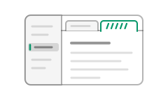

# File and folder workflows

Browse notes without losing your place, keep the documents you need, and search or export your work. Your open documents and the navigator's folder are separate: opening a file elsewhere does not replace an already open folder.

## Open and revisit

- **Open one document:** **File > Open...** (`Mod+O`) accepts `.md`, `.markdown`, `.mdown`, and `.mkd`. With no folder open, its parent becomes the navigator's folder.
- **Browse a folder:** **File > Open folder...** (`Mod+Shift+O`) scans for Markdown articles. It opens a matching root-level index file, such as `readme` or `index`, if present. Ignored directories are skipped.
- **Start a note:** **File > New** (`Mod+N`) creates an untitled tab. No file is written until you save.
- **Revisit a path:** Choose it on the welcome screen or under **File > Open recent**. Recent lists are recorded when **Record recent files and folders** is on. Removing an entry or clearing the lists does not delete files.

On Windows, Leafdown is available in File Explorer's **Open with** menu and **Settings > Apps > Default apps** after installation. Installing does not change your default app. Opening an associated file starts Leafdown or brings it forward; starting Leafdown again without a file opens a new window.

## Work with tabs

Opening a file through Open, recent items, a drop, or the operating system gives it an ordinary tab after the active one. Opening an already open file switches to its tab.

Choosing an article in the navigator, a folder-search result, a link, or a folder's index opens a **preview tab**, named in italics. Choosing another such document can reuse that tab. Editing, saving, double-clicking the tab or navigator row, or **View > Keep tab** (`Mod+Shift+K`) makes it an ordinary tab. Unsaved work is never replaced by a preview.

Each tab keeps its unsaved edits, undo history, position, and search. A dot marks unsaved changes. Use one action at a time:

- **Next tab:** **View > Next tab**, `Mod+Tab` or `Mod+PageDown`.
- **Previous tab:** **View > Previous tab**, `Mod+Shift+Tab` or `Mod+PageUp`.
- **Jump by position:** `Mod+1` through `Mod+8`; `Mod+9` selects the last tab. These commands are also in the command palette, not a menu.
- **Close the active tab:** **File > Close document**, `Mod+W`. Its close button and a middle click work too. Unsaved changes prompt before the tab closes.

Newly opened documents begin at the top. Heading links and search results bring their target into view instead.

To compare documents side by side, see [Work in more than one window](#work-in-more-than-one-window).

## Work in more than one window

1. Choose **File > New window** (`Mod+Shift+N`).
2. Open another folder or document there. Tabs, folder, navigator, folder search, and zoom belong to each window. Settings and recent items are shared.
3. Arrange the windows side by side with your operating system.

A file is open in only one window at a time. Opening it again brings its existing tab and window forward. A file opened from the operating system otherwise goes to the Leafdown window you used last.

Renaming a file or folder moves its open tabs in every window and preserves edits. Deleting closes its tabs in the deleting window; other windows keep their text and mark the file missing. Folder replacement skips a file with unsaved edits in another window and reports it.

**File > Close window** (`Alt+F4`) closes one window. **File > Quit** (`Mod+Q`) closes them all. With **Restore session** on, quitting or closing the last window keeps the windows, tabs, and unsaved edits for next launch without asking, unless saving that session fails. Closing a window while others remain open asks about its unsaved changes as usual. With restoration off, unsaved changes prompt before closing. Canceling a quit stops there, leaving that window and those not yet asked open.

## Work in the article navigator

Choose a Markdown row to preview it. Expand folders to reach nested notes. Keyboard focus moves with the arrow keys; `Enter` or `Space` opens the focused article. **View > Collapse all folders** and **Expand all folders** change the tree at once.

Right-click a row, or press `Shift+F10` on it, to open its context menu:

- **New file / New folder:** Create beside an article or inside a folder. A new file opens in an ordinary tab.
- **Rename:** Change the name while keeping open edits. Other files' links are not rewritten.
- **Delete:** Confirm before moving an entry to the system Recycle Bin or Trash. Leafdown does not permanently delete it on its own.
- **Open file location / Open folder location:** Reveal it in the system file manager.
- **Copy path / Copy relative path:** Copy an absolute path or one relative to the open folder.

Right-click empty navigator space for actions at the folder root. These context-menu actions have no default shortcuts.

**View > Show all files** includes images, PDFs, and other unsupported files as dimmed rows. They cannot be opened, renamed, or deleted here. Empty folders remain visible, including one you just created. **File > Reveal in sidebar** locates the active document when it belongs to this folder.

## Search the folder

1. Choose **Edit > Find and replace > Find in folder...** (`Mod+Shift+F`).
2. Type your query. **Match case** and **Whole word** narrow matches. Search covers the folder's Markdown articles and includes open documents' unsaved edits.
3. Choose a result to open its file and highlight the match. The arrow keys move between result rows; `Enter` opens a match.
4. Press `Escape` to return to the navigator and document, with the match selected.

Files too large to search or not valid UTF-8 or UTF-16 are skipped and listed. To search only the active note, use **Edit > Find and replace > Find...** (`Mod+F`).

## Replace across the folder

1. Choose **Edit > Find and replace > Replace in folder...** (`Mod+Shift+H`).
2. Enter the search text and **Replace with** text. The preview strikes out each match and shows its replacement beside it.
3. Review the complete preview. Changing a field or option only updates this preview; it writes nothing.
4. Choose **Replace all** once the preview is complete. If a previewed open document has unsaved edits, save or discard them when asked; the preview refreshes before writing.

Leafdown writes files in turn and reports results. A file changed since the preview, one that cannot be written, or one edited in another window is skipped and listed; other files can still be replaced. Normally only lines with replacements change. A warning-marked file is written as Save would write it and can also change formatting elsewhere, such as table padding.

> **Tip:** Back up or commit your notes before a replacement you may want to reverse. Undo affects only an open document; it cannot undo the whole folder operation.

## Drop a file or folder

Drop one supported Markdown file or folder onto Leafdown. The drag preview tells you what will happen. Multiple or unsupported items are not opened.

Under **File > Preferences... > Files**, choose whether each drop type opens the item or inserts a link. A saved document gets a relative link when the paths share a filesystem root; an untitled one gets an absolute link.

## Links and images

Relative paths begin at the saved document's location. For example, `notes/today.md` can link to a sibling with `[Tomorrow](tomorrow.md)` and to an image one folder up with ``. Save an untitled note before expecting relative paths to resolve.

Local Markdown links open in Leafdown and keep the navigator's folder pinned. Hover a link, or press `Mod+Alt+P` with the caret in it, to preview its target or named heading. Non-Markdown local links ask before opening with the system default app. Web links open in your browser.

Local images render when available. Remote HTTPS images remain placeholders until **Load image** is chosen; opening a document does not request them. Images outside the folder may need approval. See [Markdown reference](markdown-reference.md) for syntax.

## Export as HTML

1. Open the document you want to share; unsaved edits are included.
2. Choose **File > Export > Export as HTML...** (no default shortcut).
3. Choose the output location, then review any reported omissions.

The result is one HTML page that works in a browser offline. Local images, math, diagrams, and highlighted code are embedded. A remote or outside-folder image is included only if you loaded it in the document first. Exporting does not save or change the Markdown file.

## Save and external changes

Use **File > Save** (`Mod+S`) for the current file, or **File > Save as...** (`Mod+Shift+S`) for another path. Save as cannot overwrite a file open in another tab and does not switch the navigator's folder.

Leafdown watches every open file, including those outside the pinned folder:

- **Clean document changed on disk:** It reloads.
- **Edited document changed on disk:** Your edits remain and a warning appears. Saving over the external change asks first.
- **File removed:** The document remains available; Save offers Save as.

Saving retains the file's trailing blank lines, though they are not displayed as empty document lines. Selecting everything and replacing or deleting it removes those lines too.

Continue with [Settings reference](settings-reference.md) for restoration, folder scanning, and file defaults.
