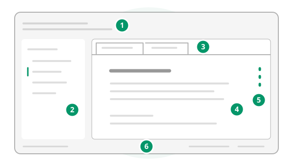

# Getting started

Open a folder of notes, choose an article, and make your first edit. Leafdown works with ordinary Markdown files on your computer. Help leaves your document and unsaved work in place.

## Find your way around



1. **Menus:** File opens and saves notes; Edit, Insert, and Format help you write. View changes the workspace, and Help opens these guides.
2. **Article navigator:** Browse the open folder and expand its subfolders. The folder stays here even if you open a document elsewhere.
3. **Document tabs:** Switch between open notes. An italic name marks a reusable preview; a dot marks unsaved changes.
4. **Document:** Write and read formatted Markdown. Moving into an element can reveal its source for editing.
5. **Outline:** Point at the heading dots on the right to see the document's headings, then choose one to jump there.
6. **Status bar:** Check unsaved state, word count, reading time, encoding, and line ending.

## Your first session

### 1. Open your notes

Choose **File > Open folder...** (`Mod+Shift+O`) and select a folder. Leafdown lists its Markdown articles and opens a root-level `readme` or `index` when one matches your configured index names.

For a single file, use **File > Open...** (`Mod+O`). Leafdown accepts `.md`, `.markdown`, `.mdown`, and `.mkd`. If no folder is open, that file's parent becomes the navigator's folder.

### 2. Choose an article

Click an article in the navigator, or use the arrow keys and press `Enter`. This opens it in the preview tab; choosing another article can replace that preview. Double-click the article or choose **View > Keep tab** (`Mod+Shift+K`) to keep it open. Editing or saving it keeps it too.

To start a fresh note instead, choose **File > New** (`Mod+N`). It stays untitled until you save it. Hide or show the navigator with **View > Toggle sidebar** (`Mod+Shift+E`).

### 3. Write something

Click the document and type. Try a heading and a short paragraph:

```text example=commonmark
# Today's notes

One small thing worth remembering.
```

Select text and choose **Format > Strong** (`Mod+B`) or **Format > Emphasis** (`Mod+I`). Turn a paragraph into a heading with **Format > Heading > Heading 1** (`Mod+Alt+1`). **Edit > Undo** (`Mod+Z`) reverses an edit.

> **Tip:** Use **View > Command palette...** (`Mod+Shift+P`) to find a command by its name or menu path. In these guides, Mod means Ctrl on Windows and Linux, or Command on macOS.

### 4. Save your work

Choose **File > Save** (`Mod+S`). For an untitled note, choose a name and location in Save as. To write an existing note to another path, choose **File > Save as...** (`Mod+Shift+S`). Saving outside the open folder leaves the navigator's folder in place.

The tab's dot disappears when its changes have been saved. Session restoration keeps unsaved work between launches, but your Markdown file changes only when you save it.

## Leave and come back

Close one tab with **File > Close document** (`Mod+W`). Leafdown asks before discarding that tab's unsaved changes. A named folder parks its tabs and drafts when you leave it or close its window. An unnamed folder or a window closed while others remain asks about unsaved work. Closing the last window keeps its session instead when restoration is on.

**File > Quit** (`Mod+Q`) keeps your windows, tabs, and unsaved edits for the next launch when **Preferences > Files > Restore session** is on, as it is by default. Turn it off to have quitting ask about unsaved changes instead.

To keep distinct sets of tabs and drafts, use **File > Named folders…**. Named folders remain available with restoration off, and closing their windows parks them. See [File and folder workflows](file-and-folder-workflows.md).

If another program changed a file, Leafdown warns before overwriting it. If the file went missing, Save offers Save as.

## Choose your next step

- [Markdown reference](markdown-reference.md) — Compare what you type with what Leafdown displays, from headings to diagrams.
- [File and folder workflows](file-and-folder-workflows.md) — Keep tabs, search a folder, follow links, and export your work.
- [Settings reference](settings-reference.md) — Set up your workspace, file defaults, and reading appearance.
