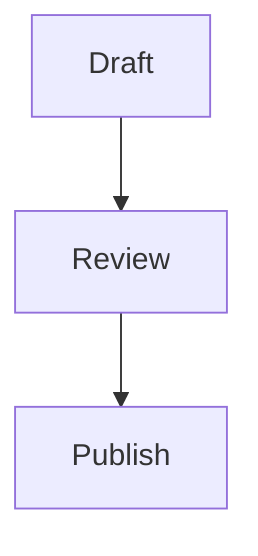

# Markdown reference

Compare what you type with what Leafdown displays. Copy an example into your document using **Edit > Paste as > Markdown** to try it. The results here are read-only; editing an element in your own document can reveal its source.

Each card names its syntax family: **CommonMark**, **GFM** (GitHub Flavored Markdown), or **Leafdown extension** (additional supported syntax, not necessarily invented by Leafdown). A command with no shortcut listed has no default shortcut. Mod means Ctrl on Windows/Linux or Command on macOS.

## Headings and paragraphs

Use one to six `#` characters followed by a space for heading levels. A blank line starts another paragraph. Headings also appear in the document outline.

```text example=commonmark
# Garden notes

## This week

Plant the seeds.

Keep the soil damp.
```

**Try it:** **Format > Heading > Heading 1–6** (`Mod+Alt+1` through `Mod+Alt+6`); **Format > Paragraph** (`Mod+Alt+0`). **Insert > Heading** and **Insert > Paragraph** add new blocks.

A normal newline within a paragraph becomes a space. End a line with a backslash for a hard line break; two trailing spaces work too.

```text example=commonmark
First line\
Second line
```

**Try it:** Press `Shift+Enter` for a hard break while writing a paragraph.

## Emphasis and inline code

Use pairs of markers around the words you want to format. Backticks keep code literal, so its stars are not emphasis.

```text example=commonmark
**Strong**, _emphasis_, and `a * b`.
```

**Try it:** Select text, then **Format > Strong** (`Mod+B`), **Emphasis** (`Mod+I`), or **Inline code** (`Mod+E`). **Format > Clear inline formatting** (`Mod+\`) removes supported inline formatting.

```text example=gfm
~~Old plan~~ New plan.
```

**Try it:** **Format > Strikethrough** (`Mod+Alt+X`).

Escape punctuation with a backslash to write it literally. Character references also work.

```text example=commonmark
\*Not emphasis\* &amp; a plain ampersand.
```

## Lists and tasks

Start a bullet list with `- `, `+ `, or `* `. Start an ordered list with `1. ` or `1) `. Saving preserves your marker except where adjacent lists need different markers to remain separate.

```text example=commonmark
- Seeds
- Water

1. Fill the pot
2. Plant the seeds
```

**Try it:** **Format > Unordered list** (`Mod+Alt+8`) or **Ordered list** (`Mod+Alt+7`). Use **Format > Increase list indent** (`Tab`) or **Decrease list indent** (`Shift+Tab`) within a list. The Insert menu also creates lists. Commands use the marker your document's lists agree on, or the default if they disagree.

```text example=gfm
- [x] Plant seeds
- [ ] Water the pots
```

**Try it:** **Format > Task list** (`Mod+Alt+9`), then **Format > Toggle task checked** (`Mod+Enter`), or click the checkbox in your document. **Insert > Task list** adds a new list.

## Quotes and separators

Prefix a paragraph with `>` to quote it. A line containing three or more matching stars, hyphens, or underscores creates a horizontal rule; surround it with blank lines to keep it separate from other blocks.

```text example=commonmark
> Start small and keep notes.

---

Next topic.
```

**Try it:** **Format > Blockquote** (`Mod+Shift+B`), **Insert > Blockquote**, or **Insert > Horizontal rule**.

## Links and images

Write a label in square brackets followed by a destination in parentheses. An image adds `!` before the label; its label describes the image. Save your document before using relative paths.

```text example=commonmark
[Example website](https://example.com)


```

The sample image has no file behind it here, so it shows a placeholder. In your saved document a local image renders when available. Remote images wait for **Load image**, and images outside the folder may need approval. See [File and folder workflows](file-and-folder-workflows.md).

**Try it:** **Insert > Link** (`Mod+K`) or **Insert > Image**. **Edit > Replace image...** changes the standalone image in context.

With the caret in a link, **Edit > Link** and the context popup offer **Copy destination**, which copies where the link points; **Remove link**, which keeps its label as ordinary text; and, for an inline link, **Choose file...**, which points it at a file you pick, relative to the saved document.

Reference links share a destination through a definition. A CommonMark autolink uses angle brackets; GFM also recognizes bare web addresses.

```text example=commonmark
[Read more][guide]

[guide]: https://example.com "Example guide"

<https://example.com>
```

```text example=gfm
Visit https://example.com for details.
```

**Try it:** Type or paste these forms. Hover a local Markdown link, or use `Mod+Alt+P` with the caret in it, to preview its document without opening it.

## Tables

Use pipes between cells and a separator row after the header. Colons in that separator set column alignment.

```text example=gfm
| Plant | Pots |
| :---- | ---: |
| Basil |    2 |
| Mint  |    1 |
```

**Try it:** **Insert > Table** creates a table. **Format > Table** adds, moves, or deletes rows and columns, and **Format > Table > Column alignment** aligns the current or selected columns. In the document, table controls provide those actions beside the table too.

Right-click in a table, or press `Shift+F10`, to open its commands. Choose the row or column selector above the action icons to select that scope and show its actions. The selectors name the current row or column, or the selected range; the header is named **Header row**, and body rows start at one. Hover an action to read its name. In column scope, **Align left**, **Align center**, and **Align right** set the columns' alignment; choose the highlighted one again to remove it. **Delete table** stays beside the selectors, after a divider. The slim grips on the table's edges select or drag rows and columns, and the `+` buttons insert at a boundary.

## Code blocks

Wrap code in three backticks or tildes. An optional language name enables highlighting when Leafdown knows it. Four leading spaces also make an indented code block, without a language badge.

````text example=commonmark
```js
const pots = 3;
```

    plain indented code
````

**Try it:** **Insert > Code block** or **Format > Code block** (`Mod+Alt+C`). Click a fenced block's language badge or use **Format > Code block language...** to change its language. Line numbers and soft wrap change presentation, never the saved code.

## Footnotes and definitions

Footnotes are supported in addition to CommonMark and GFM. A reference names a definition elsewhere in the document.

```text example=leafdown
Keep a record[^note].

[^note]: More detail about this observation.
```

**Try it:** **Insert > Footnote** creates a reference and moves to its new definition. Hover a reference, or press `Mod+Alt+P` there, to preview the definition. **Edit > Jump > Jump to footnote definition** moves to it; **Edit > Rename footnote** selects its label for replacement.

Definition lists use Pandoc-style `:` or `~` markers followed by a space.

```text example=leafdown
Term
: Its definition.

Another term
~ Another definition.
```

**Try it:** Type the term and definition on successive lines; there is no definition-list command.

## Wiki links

Wiki links target Markdown files relative to the saved document. Add a heading fragment to jump to the first exact matching heading, and a pipe to change the displayed label. Missing targets stay unresolved; they do not create files.

```text example=leafdown
[[notes/meeting]]

[[notes/meeting#Decisions|Meeting decisions]]
```

**Try it:** Type `[[` to start a wiki link. These examples have no folder context, so their destinations remain unresolved here.

**Edit > Link > Copy destination** copies a wiki link's target and heading without its label, and **Remove link** leaves the label as text.

## Math

Dollar delimiters enclose TeX. A `$$` span alone in its paragraph displays as a centered block. A fenced block with the language `math` also displays a formula. Rendering is local and loads no external resource.

````text example=leafdown
Inline math: $a^2+b^2=c^2$.

$$
E = mc^2
$$

```math
\int_0^1 x^2\,dx = \frac{1}{3}
```
````

**Try it:** Type dollar delimiters, or use **Insert > Code block** and choose `math` from its language badge. Moving into the formula reveals its source; invalid TeX stays visible for correction.

## Citations

Pandoc-style bracketed citations keep their authored text. Leafdown does not read a bibliography or format a reference list. Semicolons separate items; a prefix, locator, or `-` before `@` can qualify an item.

```text example=leafdown
As shown before [@doe2026, pp. 4-6].

[see -@roe2024; @smith2025, chap. 2]

[@{https://example.com/bib?id=7}, p. 3]
```

**Try it:** Type the bracketed form, then click or arrow into it to edit. Escape the `@` as `\@` to keep bracketed text literal instead.

## Diagrams

A fenced code block whose first info word is `mermaid` shows a diagram while the caret is elsewhere. It uses the current light or dark colors. Wide diagrams scroll horizontally. Configuration directives and frontmatter stay in the file but are not previewed.

````text example=leafdown

````

**Try it:** **Insert > Code block**, then choose `mermaid` from its language badge. Click the diagram to edit its highlighted source; the preview updates after you pause. Rendering is local and loads no external resource.

## Callouts

Callouts distinguish notes, tips, and warnings. Leafdown supports GitHub alerts, Material for MkDocs admonitions, and Docusaurus or VitePress colon fences. These are extensions beyond standard GFM; each dialect has its own types and title rules.

```text example=leafdown
> [!NOTE]
> Keep a copy of the source file.
```

```text example=leafdown
!!! warning "Before you save"
    Check changes made by another program.
```

```text example=leafdown
::: tip
Keep related articles in one folder.
:::
```

**Try it:** **Insert > Callout** lists your document's shared dialect first, or GitHub alert types when there is none or more than one. Submenus offer the other dialects. Choose a type to insert an empty callout with no title. The command palette's **Callout...** offers only the inferred dialect.

Change a callout within its dialect through **Format > Callout** or its header icon. For an MkDocs collapsible admonition, `???` starts closed and `???+` starts open; **Format > Callout > Callout opens expanded** switches that choice. Ordinary MkDocs insertion starts with `!!!`.

## Frontmatter

Frontmatter must be the first block. YAML uses `---`, TOML uses `+++`, and JSON uses `;;;` delimiters. Leafdown displays the metadata as source and gives its keys no special meaning. Invalid syntax shows an error but never blocks saving.

```text example=leafdown
---
title: Garden report
tags: [notes, garden]
---
```

```text example=leafdown
+++
title = "Garden report"
+++
```

```text example=leafdown
;;;
{"title": "Garden report"}
;;;
```

**Try it:** **Insert > Frontmatter > YAML**, **TOML**, or **JSON** adds an empty block if the document has none. Edit it directly; it saves as you left it.

## Raw HTML

Leafdown displays a restricted set of self-contained HTML elements with no attributes. Unsupported HTML remains visible source. This safe subset is narrower than CommonMark's raw HTML syntax.

```text example=leafdown
Water is H<sub>2</sub>O.

<details><summary>More</summary>A small note.</details>
```

**Try it:** Type supported HTML directly. The [Specification](https://github.com/Azganoth/leafdown/blob/main/docs/specification.md) lists the exact supported elements and extension rules. The example results in this guide are illustrations, so controls and links in them do not activate.

Continue with [File and folder workflows](file-and-folder-workflows.md) for paths, saving, and export, or [Settings reference](settings-reference.md) to adjust document typography.
