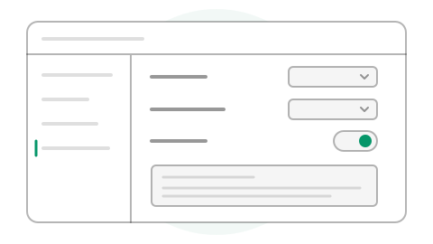

# Settings reference

Make Leafdown comfortable to read and choose how it opens, saves, and restores your work. Open **File > Preferences...** (`Mod+,`). Changes persist across launches and are shared by your windows. **Reset all settings…** asks before restoring General, Files, Editor, and Appearance preferences across Leafdown. Choose **Cancel** to leave them as they are. Resetting does not change your documents.

Choose **General**, **Files**, **Editor**, or **Appearance** on the left, then change a control on the right. Switches turn a behavior on or off; choice controls select one value. The drawing is a guide to the controls, not a second Preferences dialog.

## General

### Arrange your workspace

- **Sidebar visibility:** Show or hide the article navigator while a folder is open. **View > Toggle sidebar** (`Mod+Shift+E`) does the same.
- **Status bar visibility:** Show or hide document status, counts, encoding, and line ending. Also available as **View > Toggle status bar**.
- **Article sort order:** Choose name, modified date, or type. **View > Sort articles by** offers the same choices.
- **Show all files:** Include dimmed rows for files Leafdown cannot open. Off by default; **View > Show all files** switches it too.

Two related settings live in the workspace itself: **View > Always on top** keeps Leafdown windows above other windows, and the outline's **H1 to H6** control chooses the deepest heading level listed (H1–H3 by default). Both choices are remembered.

### Choose language and recent history

**Language** uses the operating system language or a shipped language. English is currently available.

**Record recent files and folders** keeps up to 10 entries in each list. Turning it off stops recording new entries; use the welcome screen to remove an existing entry or **File > Open recent > Clear recent items** to clear both lists. Your files are untouched.

## Files

### Return to unfinished work

Leave **Restore session** on to reopen the windows left open at quit or crash, with their assigned contexts, tabs, and unsaved text. It is on by default. Turning it off clears automatic restart state and unnamed sessions, so the next launch starts at welcome and unnamed windows ask about unsaved changes before closing. Named folders and their drafts remain available; their windows still park on close. Parked contexts stay parked until you select them.

> **Tip:** Restoring a session does not save your Markdown files. Use **File > Save** (`Mod+S`) when you want the file on disk to contain your changes.

### Set defaults for new notes

- **Default extension for new documents:** `.md` (default) or `.markdown`. Existing `.mdown` and `.mkd` files work too.
- **Default line ending for new documents:** LF or CRLF. The default follows the operating system: CRLF on Windows, LF on macOS/Linux. To change the current note, use **Edit > Line ending** or its status-bar control.
- **Insert final newline on save:** End the last content line with a newline. On by default; trailing blank lines are preserved either way. Also available under **Edit > Line ending**.

### Choose what a folder opens

**Index file names** is an ordered list of base names. The defaults are `readme`, then `index`: Leafdown tries them when opening a folder, so put your preferred landing page first. Use names without their Markdown extension.

**Ignored directories** skips named directories and their contents during scans. Defaults include `.git`, `.hg`, `.svn`, `node_modules`, `target`, `dist`, `build`, and `.cache`. Matching ignores case on Windows and respects it on Unix-like systems. An ignored directory's notes do not appear in the navigator or folder search.

### Choose what a drop does

**When dropping a folder** and **When dropping a Markdown file** each choose between opening the item and inserting a link into the active document. Both default to opening. The drag preview shows the configured action before you drop.

## Editor

### Reduce typing

**Auto pair brackets and quotes** inserts a matching closing character while you type. It is on by default. Turn it off if you prefer to type both sides yourself.

### Read code more easily

**Display line numbers for code blocks** numbers lines beside code. Numbers never become saved or copied text. A wrapped line still has only one number.

**Soft wrap for code blocks** wraps long lines visually instead of requiring horizontal scrolling. It does not insert newlines into your code. Both settings are off by default and can also be changed with the controls on a code block.

## Appearance

### Choose colors

**Appearance theme** follows System or selects Light or Dark. **View > Appearance** offers the same choices. **Accent color** selects Neutral, Red, Orange, Amber, Emerald, Cyan, Blue, Violet, or Fuchsia.

**File icons** chooses Neutral gray icons or Colored icons with amber folders and a color for each file type. This is separate from the accent color.

### Tune document reading

1. Choose a **Document font**: Inter, IBM Plex Sans, Atkinson Hyperlegible Next, Literata, or System. All except System are bundled for offline use; code keeps its monospace font.
2. Choose **Text size**: 14, 16, 18, or 20 px. Headings and other document elements scale with it.
3. Choose **Line spacing**: Compact, Default, or Relaxed. It changes paragraphs, lists, and quotes; headings and code keep their own line height.
4. Read the sample beneath those controls to compare your choices before returning to the document.

These choices affect document typography, not the interface font or saved Markdown. To enlarge the whole interface instead, use **View > Zoom in** (`Mod+=`), **Zoom out** (`Mod+-`), or **Reset zoom** (`Mod+0`).

Continue with [Getting started](getting-started.md) or [File and folder workflows](file-and-folder-workflows.md). The [repository Reference](https://github.com/Azganoth/leafdown/blob/main/docs/reference.md) contains the complete settings and command inventory.
